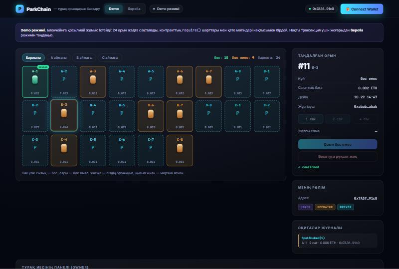
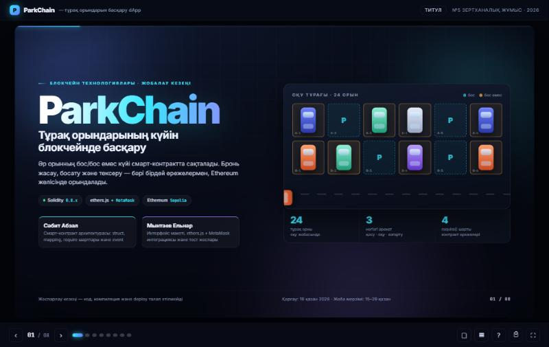
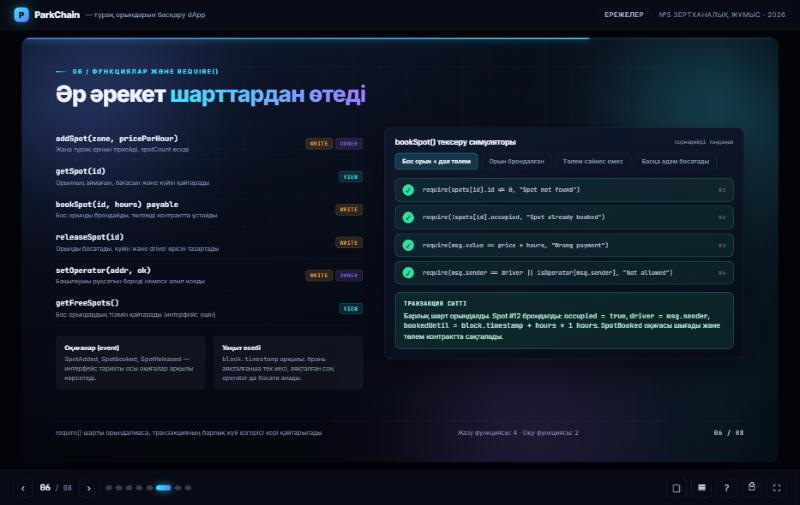
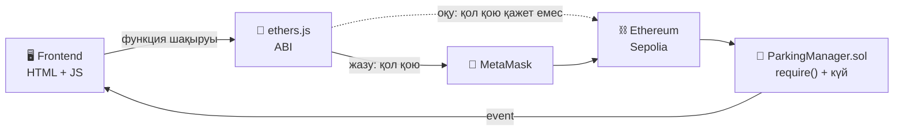

<div align="center">

# 🅿️ ParkChain

### Тұрақ орындарының күйін блокчейнде басқару

Әр орынның **бос / бос емес** күйі смарт-контрактта сақталады.
Бронь жасау, босату және тексеру — бәрі бірдей ережелермен, Ethereum желісінде.

<br>


<br>

### [🚀 Қосымшаны ашу](https://ab0ka.github.io/parkchain-dapp/) · [📊 Презентация](https://ab0ka.github.io/parkchain-dapp/presentation.html) · [📜 Контракт коды](ParkingManager.sol)

<br>



<sub>Орын торы, бронь панелі, рөлдер және оқиғалар журналы. Demo режимі — кошелексіз жұмыс істейді.</sub>

</div>

<br>

---

## 🎯 Қандай мәселені шешеді

| | Мәселе | ParkChain шешімі |
|:--:|---|---|
| **01** | **Қос бронь.** Қолмен жүргізілген тізімде бір орынға екі жүргізуші төлем жасап қалады | Контракт сатылған орынға екінші бронь жасауға жол бермейді — `require(!occupied)` |
| **02** | **Деректерге сенім.** Орталық базадағы жазбаны оператор қолмен өзгерте алады | Күй тек транзакция арқылы өзгереді, өзгеріс тарихы блокта қалады |
| **03** | **Тексерілмейтін тарих.** Орынды кім, қашан алғанын тәуелсіз тексеру мүмкін емес | Әр әрекет `event` ретінде жазылады, кез келген адам оқи алады |

> **Мақсаты:** орын күйін өзгертетін әр әрекет контракттағы бірдей `require()` шарттарынан өтеді,
> нәтижесі блокчейнде қалады. Сондықтан «бос орын бар ма?» деген сұрақтың жауабы барлығы үшін бірдей.

<br>

## ✨ Мүмкіндіктер

| | |
|---|---|
| 🧩 **Екі режим** | **Demo** — кошелексіз, бірден іске қосылады. **Sepolia** — нақты транзакциялар |
| 👀 **Кошелексіз оқу** | Контракт адресі белгілі болса, орын торы MetaMask-сыз көрінеді (`view` сұрауы, газ төленбейді) |
| ⬆️ **Беттен deploy** | Контракттың bytecode-ы қосымшаға салынған — Remix ашудың қажеті жоқ, бір батырма |
| 🔐 **Рөлдер** | `owner` орын қосады, `driver` брондайды, `operator` мерзімі өткен бронды босатады |
| 🧾 **Оқиғалар журналы** | `SpotBooked` / `SpotReleased` оқиғалары тікелей блокчейннен оқылады |
| 🛡 **Алдын ала тексеру** | Транзакция жібермес бұрын шарттар тексеріліп, нақты `require()` мәтіні көрсетіледі |

<br>

## 🖼 Скриншоттар

<table>
<tr>
<td width="50%">



**Презентация — титул**
8 слайд, анимациялы, қазақ тілінде

</td>
<td width="50%">



**require() симуляторы**
Сценарийді таңдағанда шарттар кезекпен тексеріледі

</td>
</tr>
</table>

<br>

## 🏗 Архитектура



**Жазу жолы** — транзакция: газ төленеді, MetaMask қол қоюды сұрайды, күй өзгереді.
**Оқу жолы** — `view` сұрауы: қол қою да, газ да қажет емес, деректер RPC арқылы тікелей оқылады.

`ABI` — контракт функцияларының аты, параметрлері мен қайтаратын мәнін сипаттайтын JSON.
Frontend оны пайдаланып қай функцияны қалай шақыратынын біледі; онсыз байт-кодпен сөйлесу мүмкін емес.

<br>

## 📜 Смарт-контракт

### Деректер құрылымы

```solidity
struct Spot {
    uint    id;            // орын нөмірі
    string  zone;          // аймақ: "A", "B", "C"
    uint    pricePerHour;  // сағаттық баға, wei
    bool    occupied;      // бос емес күйі
    address driver;        // ағымдағы жүргізуші
    uint    bookedUntil;   // бронь аяқталатын уақыт
}

mapping(uint    => Spot)    public spots;       // орынның күйі
mapping(uint    => Booking) public bookings;    // соңғы бронь
mapping(address => bool)    public isOperator;  // бақылаушы рұқсаты
```

> Орын **ешқашан жойылмайды** — тек күйі өзгереді. Сондықтан брондау тарихы сақталады.

### Функциялар

| Функция | Түрі | Қызметі |
|---|:--:|---|
| `addSpot(zone, price)` | 🟠 write · owner | Жаңа тұрақ орнын тіркейді |
| `addSpots(zone, count, price)` | 🟠 write · owner | Бірнеше орынды бір транзакциямен қосады |
| `bookSpot(id, hours)` | 🟠 write · payable | Бос орынды брондайды, төлемді ұстайды |
| `releaseSpot(id)` | 🟠 write | Орынды босатады |
| `setOperator(addr, ok)` | 🟠 write · owner | Бақылаушы рұқсатын береді |
| `withdraw()` | 🟠 write · owner | Жиналған төлемді шығарады |
| `getSpot(id)` | 🔵 view | Бір орынның деректері |
| `getAllSpots()` | 🔵 view | Барлық орын — интерфейс торы үшін |
| `getFreeSpots()` | 🔵 view | Бос орындардың нөмірлері |

### Тексеру шарттары

| № | Шарт | Қате мәтіні |
|:--:|---|---|
| **R1** | `spots[id].id != 0` | `Spot not found` |
| **R2** | `!spots[id].occupied` | `Spot already booked` |
| **R3** | `msg.value == pricePerHour * hoursCount` | `Wrong payment` |
| **R4** | `driver == msg.sender \|\| (isOperator && expired)` | `Not allowed` |

Қосымша: `Only owner`, `Hours must be 1..24`, `Price must be above zero`, `Nothing to withdraw`.

> `require()` шарты орындалмаса, транзакцияның **барлық күй өзгерісі кері қайтарылады**.

<br>

## 🚀 Іске қосу

### Нұсқа 1 — Demo режимі (0 секунд дайындық)

[Қосымшаны ашыңыз](https://ab0ka.github.io/parkchain-dapp/) — болды.
24 орын жадта жұмыс істейді, контракттың `require()` шарттары мен қате мәтіндері нақтысымен бірдей.

### Нұсқа 2 — нақты блокчейн (Sepolia)

**1. Дайындық**

- MetaMask орнатыңыз, желіні **Sepolia** деп таңдаңыз
- Тегін test ETH алыңыз: [Google Cloud faucet](https://cloud.google.com/application/web3/faucet/ethereum/sepolia) немесе [sepoliafaucet.com](https://sepoliafaucet.com)
- 0.05 ETH әбден жеткілікті

**2. Контрактты deploy жасау**

Қосымшада **Sepolia** режимін таңдап → **Connect Wallet** → **⬆ Жаңа контракт deploy жасау**.
MetaMask растауды сұрайды (≈0.003 ETH газ), адрес автоматты толтырылады.

<details>
<summary>Remix арқылы жасағыңыз келсе</summary>

1. [remix.ethereum.org](https://remix.ethereum.org) ашыңыз
2. `ParkingManager.sol` файлын жасап, [осы кодты](ParkingManager.sol) көшіріңіз
3. **Solidity Compiler** → нұсқасы **0.8.20+** → Compile
4. **Deploy & Run** → Environment: **Injected Provider — MetaMask** → Sepolia → Deploy
5. Шыққан адресті қосымшадағы өріске қойып, **Контрактқа қосылу** басыңыз

</details>

**3. Орындарды толтыру**

Owner панелінен **«24 орын (A·B·C)»** — үш транзакциямен A, B, C аймақтары қосылады
(0.003 / 0.002 / 0.001 ETH сағатына).

<br>

## 🎓 Қорғауда не көрсету

| Қадам | Нәтижесі |
|---|---|
| Бос орынды басып, 2 сағ таңдап, **Бронь жасау** | MetaMask → транзакция → орын сарыға айналады, `SpotBooked` журналда |
| Сол орынды қайта брондауға тырысу | `revert: Spot already booked` — екінші бронь жазылмайды |
| Басқа аккаунттан бөтен бронды босату | `revert: Not allowed` |
| Өз орныңызды **босату** | Орын қайта көк болады, `SpotReleased` оқиғасы |
| Аймақ сүзгісі, «бос / бос емес» есептегіші | `getAllSpots()` — **view**, газ төленбейді |
| Кошелекті ажыратып, бетті жаңарту | Орын торы бәрібір көрінеді — оқу үшін кошелек қажет емес |

<br>

## ✅ Тексеру нәтижелері

Контракт жергілікті EVM-де (ganache) deploy жасалып, қосымшаның нақты ABI-ымен тексерілді:

```
✓ owner() = deployer              ✓ bookSpot кейін occupied = true
✓ spotCount() = 24                ✓ driver өрісі жаңарды
✓ getAllSpots() ұзындығы = 24     ✓ bookedUntil белгіленді
✓ spot.zone = "A" (string)        ✓ contractBalance = 0.006 ETH
✓ spot.pricePerHour = 0.003 ETH   ✓ releaseSpot: иесі босата алады
✓ spot.occupied = false (bool)    ✓ SpotBooked оқиғасы жазылды
                              … 18 тексеру өтті
```

Сондай-ақ: `solc 0.8.26` — қате де, ескерту де жоқ (bytecode 11 385 байт, лимит 24 576);
қосымшадағы ABI-дың барлық функция селекторы мен оқиға топигі контракттағымен сәйкес келеді.

<br>

## ❓ Қорғауға арналған сұрақтар

<details>
<summary><b>dApp пен дәстүрлі веб-қосымшаның айырмашылығы қандай?</b></summary><br>

Мұнда сервер де, дерекқор да жоқ. Ережелер смарт-контрактта орындалады, деректер блокчейнде сақталады.
Дәстүрлі қосымшада «орын бос» деген жазбаны әкімші қолмен өзгерте алады, мұнда — тек контракт ережесі арқылы.
</details>

<details>
<summary><b>MetaMask, ethers.js және ABI не үшін қажет?</b></summary><br>

**MetaMask** — аккаунтты қосады және транзакцияға қол қояды, жеке кілт браузерден шықпайды.
**ethers.js** — функция шақыруын дайындайтын және нәтижені оқитын кітапхана.
**ABI** — контракт функцияларының тізімі мен параметр түрлерін сипаттайтын JSON, онсыз frontend контрактпен сөйлесе алмайды.
</details>

<details>
<summary><b>struct, mapping және require() қандай рөл атқарады?</b></summary><br>

**struct** — бір объектінің өрістерін біріктіреді (`Spot`: нөмір, аймақ, баға, күй).
**mapping** — кілт арқылы жылдам іздеу (`spots[12]` → 12-орын).
**require()** — шартты тексереді; орындалмаса транзакция толық кері қайтарылады.
</details>

<details>
<summary><b>Қай функциялар деректі өзгертеді, ал қайсысы тек оқиды?</b></summary><br>

Өзгертетіндері (газ алады): `addSpot`, `addSpots`, `bookSpot`, `releaseSpot`, `setOperator`, `withdraw`.
Тек оқитындары (тегін, `view`): `getSpot`, `getAllSpots`, `getFreeSpots`, `spots`, `owner`, `isOperator`.
</details>

<br>

## 📁 Файлдар

| Файл | Не үшін |
|---|---|
| [`ParkingManager.sol`](ParkingManager.sol) | Solidity контракты — struct, mapping, 9 функция, event |
| [`index.html`](index.html) | dApp интерфейсі — ethers.js + MetaMask, Demo және Sepolia режимдері |
| [`presentation.html`](presentation.html) | №5 кезеңнің 8 слайдтық презентациясы |

<br>

## ⚠️ Ескертпелер

- Уақыт `block.timestamp` арқылы есептеледі — дәлдігі блок уақытына байланысты
- Төлем контрактта сақталады, босатқанда қайтарылмайды — оны owner `withdraw()` арқылы алады
- `string zone` газды көбірек жейді; оптимизация керек болса `bytes32` нұсқасына көшуге болады
- Бұл — **оқу жобасы**, нақты тұрақта пайдалануға арналмаған

<br>

---

<div align="center">

### Команда

**Сәбит Абзал** — смарт-контракт архитектурасы, `struct`, `mapping`, `require()` шарттары
**Мынтаев Ельнар** — интерфейс макеті, `ethers.js` + MetaMask интеграциясы, тест жоспары

<br>

<sub>Блокчейн технологиялары · №5–№7 зертханалық жұмыс · 2026</sub>

</div>
